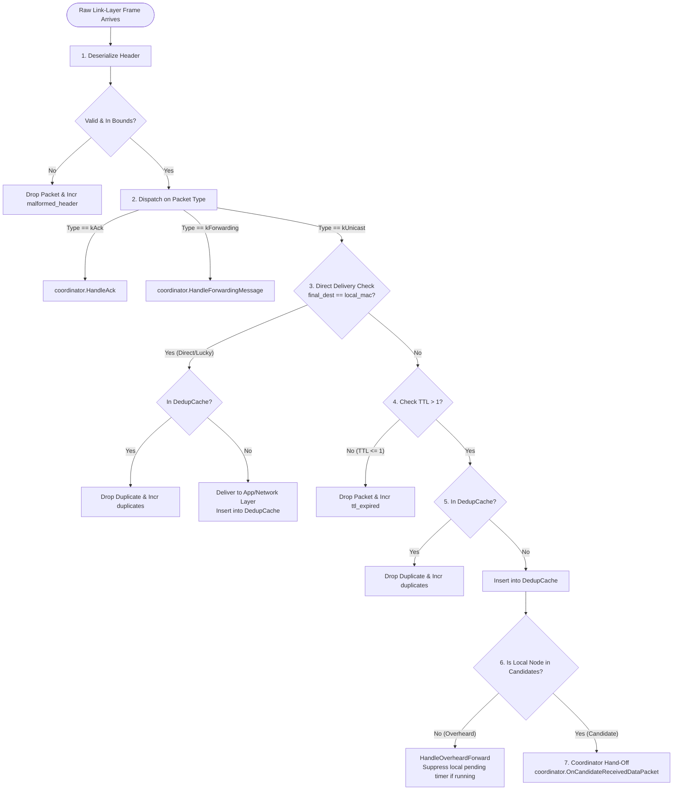

# 03 — Packet Formats & State Machines

This document provides the binary wire-level layout of JOKER protocol headers and the core finite state machines governing packet classification, deduplication, and transmission.

---

## 1. Binary Wire-Format Specification

JOKER headers are serialized directly onto raw layer-2 frames or encapsulated inside UDP payloads. Multi-byte integers are strictly encoded in **Network Byte Order (Big-Endian)**.

### 1.1 Complete JOKER Frame Layout

```
 0                   1                   2                   3
 0 1 2 3 4 5 6 7 8 9 0 1 2 3 4 5 6 7 8 9 0 1 2 3 4 5 6 7 8 9 0 1
+-+-+-+-+-+-+-+-+-+-+-+-+-+-+-+-+-+-+-+-+-+-+-+-+-+-+-+-+-+-+-+-+
|  Type (1B)    |   TTL (1B)    | NumCand (1B)  |               |
+-+-+-+-+-+-+-+-+-+-+-+-+-+-+-+-+-+-+-+-+-+-+-+-+               +
|                      Packet ID (4B, CRC-32)                   |
+-+-+-+-+-+-+-+-+-+-+-+-+-+-+-+-+-+-+-+-+-+-+-+-+-+-+-+-+-+-+-+-+
|                                                               |
+                    Final Destination MAC (6B)                 +
|                                                               |
+-+-+-+-+-+-+-+-+-+-+-+-+-+-+-+-+-+-+-+-+-+-+-+-+-+-+-+-+-+-+-+-+
|                                                               |
+                   Other Candidate #1 MAC (6B) [Optional]      +
|                                                               |
+-+-+-+-+-+-+-+-+-+-+-+-+-+-+-+-+-+-+-+-+-+-+-+-+-+-+-+-+-+-+-+-+
|                              ...                              |
+-+-+-+-+-+-+-+-+-+-+-+-+-+-+-+-+-+-+-+-+-+-+-+-+-+-+-+-+-+-+-+-+
|                                                               |
+                   Other Candidate #K MAC (6B) [Optional]      +
|                                                               |
+-+-+-+-+-+-+-+-+-+-+-+-+-+-+-+-+-+-+-+-+-+-+-+-+-+-+-+-+-+-+-+-+
|                      Payload Data (Variable)                  |
|                              ...                              |
+-+-+-+-+-+-+-+-+-+-+-+-+-+-+-+-+-+-+-+-+-+-+-+-+-+-+-+-+-+-+-+-+
```

### 1.2 Header Field Definitions

| Field | Size | Type / Values | Description |
| :--- | :---: | :--- | :--- |
| **`Type`** | 1 Byte | `0x00`: Unicast Data<br>`0x01`: ACK Control<br>`0x02`: Forwarding Control | Identifies the protocol function of the frame. |
| **`TTL`** | 1 Byte | `uint8_t` (Default: 32) | Time-To-Live. Decremented on every candidate forward; packet dropped if $\le 1$. Prevents routing loops. |
| **`NumCand`** | 1 Byte | `uint8_t` ($0 \le N \le 7$) | Engineering field indicating how many candidate MACs follow in the header. |
| **`Packet ID`** | 4 Bytes | `uint32_t` (Big-Endian CRC-32) | Monotonically unique identifier computed across packet payload + sequence counter. |
| **`Final Destination`** | 6 Bytes | IEEE 802.3 MAC Address | Ultimate target node of the packet. Used for Lucky Long direct delivery check. |
| **`Other Candidates`** | $6 \times K$ Bytes | Array of 6-Byte MACs | Backup candidate forwarders ranked in descending priority order. |
| **`Payload`** | Variable | Raw Bytes | Upper-layer encapsulated data (IP packet, text, media chunks). |

#### Wire Size Formula:
$$\text{Header Wire Size} = 13 + 6 \times K \text{ bytes}$$
Where $K = \text{other\_candidates.size()}$.

---

## 2. In-Memory Header Structure (`include/joker/header.hpp`)

In C++20, the header is defined as:

```cpp
namespace joker {

enum class PacketType : uint8_t {
    kUnicast    = 0,  // Data packet carrying payload
    kAck        = 1,  // Control packet for ACK-based coordination
    kForwarding = 2,  // Control packet notifying elected candidate
};

struct JokerHeader {
    PacketType              type;                 // 1 byte
    uint8_t                 ttl;                  // 1 byte (default: 32)
    uint8_t                 num_candidates;       // 1 byte
    uint32_t                packet_id;            // 4 bytes (CRC-32)
    MacAddress              final_destination;    // 6 bytes
    std::vector<MacAddress> other_candidates;     // 6 bytes each
    
    [[nodiscard]] size_t WireSize() const {
        return 13 + 6 * other_candidates.size();
    }
};

} // namespace joker
```

---

## 3. Central RX Processing Pipeline (`process_received_frame`)

Every frame arriving from the network interface enters `process_received_frame()` in [`src/forwarding.cpp`](file:///home/nkandasamy/Desktop/Joker_protocol/src/forwarding.cpp). This single choke-point enforces all JOKER protocol invariants:



---

## 4. Deduplication Cache Architecture (`src/dedup_cache.cpp`)

Because opportunistic routing deliberately encourages multi-node overhearing, duplicate packets are a natural phenomenon over the air. The `DedupCache` provides:
1. **$O(1)$ Hash Lookup**: An `std::unordered_map<uint32_t, ...>` for instantaneous duplicate checks.
2. **LRU Eviction**: An `std::list<uint32_t>` maintaining arrival order when the capacity limit (default: 1000 packets) is reached.
3. **Time-Based Expiration**: Entries older than the sliding TTL window (default: 5000 ms) are pruned during lookups.

```
       [ Lookup: packet_id ]
                 │
                 ▼
       ┌───────────────────┐
       │ std::unordered_map│ ──(Found?)──> Check timestamp ──(Expired?)──> Prune
       └───────────────────┘                      │                             │
                 │ (Not found)                    ▼                             ▼
                 ▼                           Return TRUE                   Return FALSE
            Return FALSE                     (Duplicate!)
```

### Invariant: Sender Pre-Population
When a node originates and transmits a data packet, it **must immediately insert its own `packet_id` into its `DedupCache`**. If the packet reflects back via broadcast socket loopback or is relayed by a neighbor, the originating node will recognize it as already seen and suppress it from bubbling up to the user interface.
