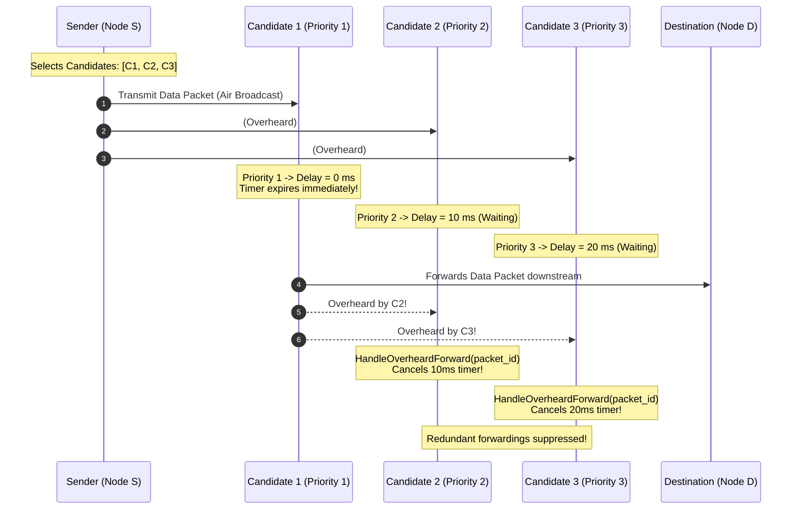
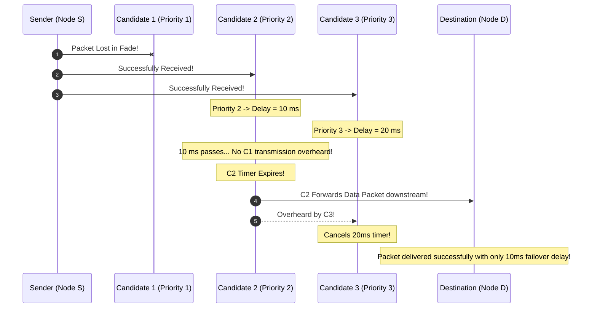
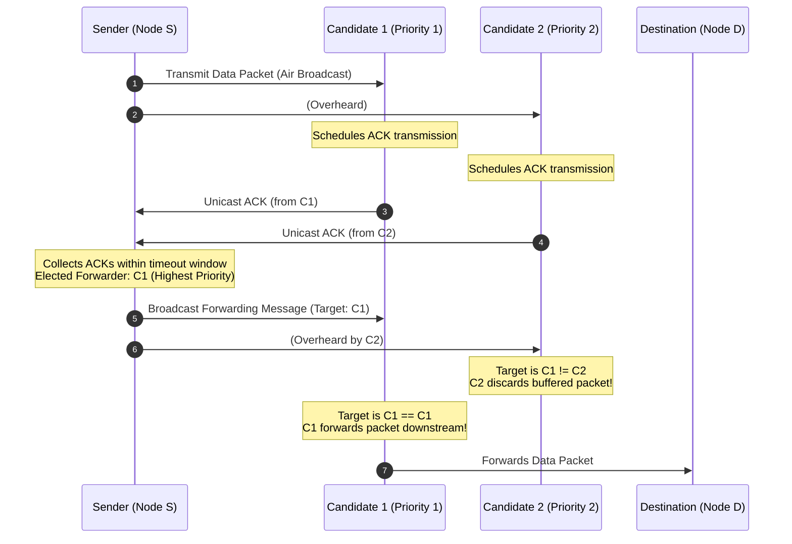

# 04 — Coordination Schemes: Timer vs. ACK

In opportunistic routing, when multiple candidate nodes overhear a packet, the protocol must elect **exactly one** candidate to forward the packet downstream towards the destination, while suppressing the remaining candidates.

JOKER provides two distinct coordination schemes:
1. **JOKER-Timer (Timer-Based Coordination)**
2. **JOKER-ACK (Acknowledgment-Based Coordination)**

---

## 1. JOKER-Timer (Timer-Based Coordination)

**Primary Use Case**: Delay-sensitive multimedia traffic (live video streaming, VoIP, interactive P2P messaging).

### 1.1 Operating Philosophy
JOKER-Timer injects **zero control packets** into the network. It coordinates candidates entirely through passive overhearing and delay-slotted timer countdowns.

### 1.2 Sequence Flow

### 1.3 Failure & Failover Scenario

What happens if the primary candidate ($C_1$) fails to receive the packet due to a momentary fade?

### 1.4 Trade-Off Analysis: JOKER-Timer
- **Strengths**:
  - Fastest forwarding latency (0 ms in the common case when $C_1$ receives the frame).
  - Absolutely zero control packet overhead.
  - Video stream MOS remains high under dynamic wireless channel fluctuations.
- **Weaknesses**:
  - If a hidden terminal prevents $C_2$ from overhearing $C_1$'s transmission, $C_2$ may also forward after 10ms, creating a transient duplicate frame downstream (which downstream `DedupCache` prunes).

---

## 2. JOKER-ACK (Acknowledgment-Based Coordination)

**Primary Use Case**: Loss-intolerant, bandwidth-constrained data transfers where zero duplicate transmissions are strictly mandated.

### 2.1 Operating Philosophy
JOKER-ACK uses a two-phase handshake:
1. Candidates that receive the data packet reply with a link-layer `ACK` packet.
2. The sender collects incoming ACKs, selects the highest-priority candidate that responded, and broadcasts a `Forwarding` control message declaring that candidate as the elected forwarder.

### 2.2 Sequence Flow

### 2.3 Trade-Off Analysis: JOKER-ACK
- **Strengths**:
  - Strictly zero duplicate forwardings downstream.
  - Complete certainty on which node accepted responsibility for the packet.
- **Weaknesses**:
  - Requires 2 additional control packet airtimes (`ACK` + `Forwarding`).
  - Higher forwarding latency per hop.
  - Contention between concurrent ACKs if candidate priorities are not slotted.

---

## 3. Comparison Matrix

| Property | JOKER-Timer | JOKER-ACK |
| :--- | :---: | :---: |
| **Control Packets Injected** | **0** | **2 per hop** (`ACK` + `Forwarding`) |
| **Primary Forwarding Latency** | **0 ms** | **1 RTT** (~10–30 ms) |
| **Failover Delay** | $T_{\text{wait}} \times (\text{rank} - 1)$ (10–20 ms) | Timeout + Retry (~50–100 ms) |
| **Duplicate Packet Probability** | Low ($\approx 2\text{--}5\%$, hidden node dependent) | **0%** |
| **Best Traffic Profile** | Video streaming, audio, real-time telemetry | Large bulk files, critical sensor telemetry |
| **Implementation Complexity** | Simple (Timer Wheel + Overhearing) | Complex (Two-phase state machine + ACK buffers) |
